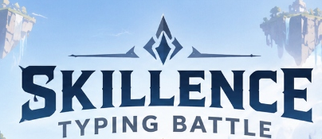

# Skillence Typing Battle

> A 2D typing-based fighting game for Skillence Academy students built with React, TypeScript, Vite, Web Audio API, and Phaser/Canvas VFX.



---

## 🌟 Overview & Visual Design

Skillence Typing Battle turns high-speed typing into an arcade anime-fantasy fighting match. Players compete against human-paced AI bots (or classmates in private rooms) by accurately typing target words. Every completed word unleashes an elemental energy blast across the arena, dealing a knockout blow. The first fighter to reach **3 kills** claims match victory.

The visual style directly recreates the approved reference artwork:
- **Floating Island Colosseum Arena:** Floating sky castles, waterfalls, and ancient stone architecture.
- **Blue Fighter (Player 1):** Sword-wielding anime warrior with blue cape, dynamic lunging spellcast, and blue energy projectile.
- **Pink Fighter (Player 2 / Bot):** Dual-twintail battle fighter with pink ribbons, energy burst counterattacks, and recoil physics.
- **Beveled Arc Glass HUD:** Hexagonal player brackets, live heart loss counters, kill counters, and ornate word scrolls.

---

## 🎮 Core Features

### 1. Home Screen
- **Full-screen 16:9 responsive viewport** with ambient floating animations.
- **Continuous Idle Animations:** Gentle breathing, micro-swaying, and stance adjustments on both fighters.
- **Interactive Menu:**
  - `PLAY`: Opens the Mode Selection screen.
  - `SETTINGS`: Adjusts audio volumes, toggles music/SFX, fullscreen, and reduced motion.
  - `QUIT`: Safe exit screen explaining browser tab closure policies.

### 2. Mode Selection
- **NORMAL PLAY (vs Bot):**
  - **Easy:** 15–25 WPM, 3–5 character words.
  - **Medium:** 26–45 WPM, 5–8 character words.
  - **Hard:** 46–70 WPM, 7–12 character words.
- **MULTIPLAYER:** Reserved for public matchmaking API (*Coming Soon*).
- **SKILLENCE ACADEMY STUDENT:** Dedicated portal with PIN authentication and private room creation.

### 3. Combat & Typing Engine
- **Mandatory 3-Second Countdown:** Sequence (`3 → 2 → 1 → GO!`) before Round 1 of every match. Typing and bot logic remain strictly locked during countdown. Subsequent rounds transition smoothly without repeating countdown.
- **Bot Typing Simulation:** Simulates human keystroke speeds according to standard typing measurements (1 word = 5 characters; `Typing Time = (CharCount / 5 / WPM) * 60s`) with realistic micro-pauses.
- **Live Input Feedback:** Real-time character matching with error highlighting in crimson red and quiet audio cues. Instant word completion without requiring the Enter key.
- **Dynamic Projectiles & Screen Shake:** High-speed 60 FPS blue & pink energy lances with muzzle flashes, light trails, particle bursts, and impact screen shake (250–350ms).
- **First to 3 Kills:** Synchronized heart loss and kill counters. Match ends with a celebration fanfare, confetti blast, and `YOU WIN!` / `YOU LOST!` popups with instant `PLAY AGAIN` and `EXIT` options.

### 4. Audio Synthesizer (Web Audio API)
- Zero external audio file download dependencies.
- Synthesizes all menu hovers, button clicks, countdown ticks, GO! horns, typing taps, error buzzes, energy blasts, impact crunches, victory fanfares, defeat sequences, and looping battle ambient techno background music.
- Persists user volume preferences in `localStorage`.

### 5. Student Login & Private Rooms
- Masked Student PIN field (1–6 numeric digits).
- Private Room generator (`SB-XXXX`) with 1-click clipboard copy.
- Host PIN protection (1–6 digits numeric).
- Waiting for Opponent screen with host display name and cancellation button.
- Join Room dialog with room code and PIN validation.
- Detects whether Supabase credentials are configured in `.env` and provides clear development preview states.

---

## 🚀 Getting Started

### Prerequisites
- [Node.js](https://nodejs.org/) v18+ (tested on Node v24.19.0)
- npm v9+

### Installation
```bash
# Clone repository
git clone https://github.com/usrnixxar/skillfight.git
cd skillfight

# Install dependencies
npm install
```

### Running Locally
```bash
# Start Vite development server
npm run dev
```
Open [http://localhost:3000](http://localhost:3000) in your desktop browser.

### Building for Production
```bash
npm run build
```
The compiled, optimized production bundle will be created in the `dist/` directory.

---

## 🌐 Deploying to Vercel

This repository includes a preconfigured `vercel.json` optimized for Vite:
1. Push your changes to the GitHub repository: `https://github.com/usrnixxar/skillfight.git`.
2. Go to [Vercel](https://vercel.com/) and click **New Project**.
3. Import the `usrnixxar/skillfight` repository.
4. Select **Vite** as framework preset (configured automatically).
5. (Optional) In Project Settings > Environment Variables, add:
   - `VITE_SUPABASE_URL`: Your Supabase Project URL
   - `VITE_SUPABASE_ANON_KEY`: Your Supabase Public Anon Key
6. Click **Deploy**.

---

## 📁 Project Structure

```
skillfight/
├── assets/
│   ├── reference/         # Approved visual reference screenshots
│   └── extracted/         # Extracted logos, character poses & HUD portraits
├── public/
│   └── assets/            # Static assets served in production
├── src/
│   ├── audio/
│   │   └── soundManager.ts   # Web Audio API sound effects & dynamic BGM loop
│   ├── components/
│   │   ├── BattleFxCanvas.tsx # 60 FPS projectile, muzzle flash & particle burst
│   │   ├── SideCharacters.tsx # Animated side fighters (idle, typing, attack, hit)
│   │   └── TopLogo.tsx        # Responsive Skillence Typing Battle logo
│   ├── game/
│   │   └── wordBank.ts        # Word bank stratified by difficulty length
│   ├── multiplayer/
│   │   └── supabaseClient.ts  # Supabase client & environment variable detection
│   ├── screens/
│   │   ├── HomeScreen.tsx     # Home screen with PLAY / SETTINGS / QUIT
│   │   ├── ModeSelectScreen.tsx# Mode selection (EASY / MEDIUM / HARD / Student)
│   │   ├── BattleScreen.tsx   # Core battle engine, countdown, HUD & bot logic
│   │   ├── SettingsScreen.tsx # Volume sliders, music/SFX toggles & controls
│   │   ├── StudentScreen.tsx  # Student PIN login, room creation & waiting room
│   │   └── QuitScreen.tsx     # Safe browser exit guidance screen
│   ├── styles/
│   │   └── game.css           # Complete CSS design system, 16:9 layout & animations
│   ├── types/
│   │   └── game.ts            # TypeScript interfaces, states & constants
│   ├── App.tsx                # Master state machine & keyboard listener
│   ├── main.tsx               # React DOM entry point
│   └── vite-env.d.ts
├── index.html                 # HTML entry with SEO meta tags & font preloads
├── package.json
├── tsconfig.json
├── vercel.json
└── README.md
```

---

## 🛡️ License & Brand
Created for **Skillence Academy**. All rights reserved.
